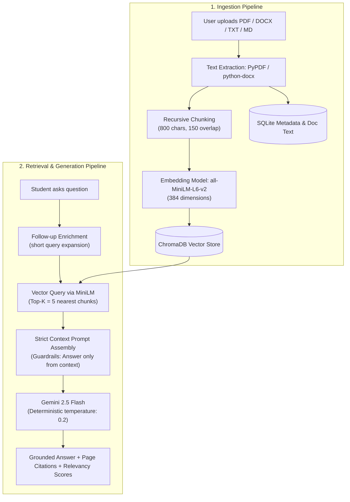

# 📚 DocuMentor AI

> **Intelligent, hallucination-resistant RAG learning assistant that transforms course documents into strictly grounded conversational answers, executive study summaries, interactive 3D flashcards, and knowledge-check quizzes.**

[](https://fastapi.tiangolo.com)
[](https://react.dev)
[](https://www.trychroma.com)
[](https://ai.google.dev)
[](LICENSE)

---

## 📑 Table of Contents
- [Overview](#overview)
- [How RAG Works Here](#how-rag-works-here)
- [Key Features](#key-features)
- [Tech Stack](#tech-stack)
- [Quick Start](#quick-start)
  - [Option A: One-Command Docker Setup](#option-a-one-command-docker-setup-recommended)
  - [Option B: Local Development Setup](#option-b-local-development-setup)
- [Environment Variables](#environment-variables)
- [Testing & Quality Assurance](#testing--quality-assurance)
- [Project Structure](#project-structure)
- [API Overview](#api-overview)
- [Screenshots](#screenshots)
- [Team](#team)
- [Troubleshooting](#troubleshooting)

---

## 🎯 Overview

DocuMentor AI is built specifically for university students, educators, and self-learners who want to master complex textbooks, lecture slide decks, and class notes without hallucinated answers. By pairing **local sentence embeddings (`all-MiniLM-L6-v2`)** and **ChromaDB vector indexing** with **Gemini 2.5 Flash**, DocuMentor ensures every answer is strictly verifiable with source file names, page numbers, and similarity scores.

---

## 🧠 How RAG Works Here



1. **Ingestion & Parsing**: Documents up to 20MB are validated and parsed into plaintext preserves per-page markers for citations.
2. **Chunking**: Text is segmented into 800-character windows with a 150-character sliding overlap to preserve contextual continuity.
3. **Local Embedding**: Chunks are embedded into 384-dimensional dense vectors using HuggingFace's `all-MiniLM-L6-v2` running locally on CPU.
4. **Strict Grounding**: The top-5 most relevant chunks are injected into a strict system prompt instructing Gemini 2.5 Flash to decline answering if the fact is not explicitly present in the provided context.

---

## ✨ Key Features

- **Document Ingestion & Library**: Drag-and-drop upload for PDF, DOCX, TXT, and Markdown files up to 20MB with real-time upload progress, embedding processing feedback, file status badges, and deletion confirmations.
- **Strict RAG Document Chat**: Conversational AI assistant whose responses are strictly grounded in user-selected study materials, complete with collapsible page-level source citations and relevance scores.
- **Chat Session Persistence**: Conversations persist across page reloads in `localStorage` and can be restored or cleared with a dedicated "New Chat" option.
- **Executive Study Summaries**: Generates structured Markdown summaries highlighting key objectives, core concepts, theorems, and recommended exam review points.
- **Interactive 3D Flashcards**: Flip cards with front (question) and back (verified answer) views, keyboard navigation (`Space`, `←`, `→`), shuffle capability, and configurable deck sizes (5, 10, 15).
- **Knowledge Check Quizzes**: Multiple-choice quizzes with instant correctness feedback (green/red), comprehensive explanations, dynamic scorekeeping, and end-of-quiz score summary screens.
- **Modern Responsive Design & Dark Mode**: Built with Tailwind CSS, sleek typography, accessible focus states, responsive layouts for mobile/tablet/desktop, and theme toggle persisting in `localStorage`.
- **Backend Health & Error Banner**: Automatic connectivity heartbeat checking every 30s (5s when offline) with retry triggers and human-readable error toasts for 400/404/413/422/500/502 errors.
- **Mock Mode for Offline Development**: Toggleable `VITE_USE_MOCK=true` mode allowing full frontend exploration without requiring the backend server.

---

## 🛠️ Tech Stack

| Layer | Technologies |
|---|---|
| **Frontend** | React 18, Vite, Tailwind CSS, Lucide React, React Router DOM v6, Axios, React Hot Toast, React Markdown |
| **Backend** | Python 3.11+, FastAPI, Uvicorn, SQLAlchemy, SQLite, Pydantic v2 / Settings |
| **Vector & AI** | ChromaDB, `sentence-transformers` (`all-MiniLM-L6-v2`), Google Gemini (`google-genai` SDK) |
| **Parsers** | `pypdf`, `python-docx` |
| **Containerization** | Docker, Docker Compose, Multi-stage Node/Nginx, Python 3.11-slim CPU |

---

## 🚀 Quick Start

### Option A: One-Command Docker Setup (Recommended)

1. Clone repository:
   ```bash
   git clone https://github.com/yashw72/Lumina.git
   cd Lumina
   ```
2. Configure your Gemini API key in `backend/.env`:
   ```bash
   cp backend/.env.example backend/.env
   # Edit backend/.env and paste your GEMINI_API_KEY
   ```
3. Run with Docker Compose:
   ```bash
   docker compose up --build
   ```
4. Access the apps:
   - **Frontend UI:** [http://localhost:5173](http://localhost:5173)
   - **Backend API & Swagger Docs:** [http://localhost:8000/docs](http://localhost:8000/docs)
   - **API Health Check:** [http://localhost:8000/api/health](http://localhost:8000/api/health)

---

### Option B: Local Development Setup

#### 1. Backend Setup
```bash
# Navigate to backend directory
cd backend

# Create virtual environment
python -m venv .venv

# Activate virtual environment
# Windows PowerShell:
.\.venv\Scripts\Activate.ps1
# macOS / Linux:
source .venv/bin/activate

# Install dependencies (CPU PyTorch + requirements)
pip install torch --index-url https://download.pytorch.org/whl/cpu
pip install -r requirements.txt

# Configure environment variables
cp .env.example .env
# Edit backend/.env and add your GEMINI_API_KEY

# Launch FastAPI development server
uvicorn app.main:app --reload --port 8000
```

#### 2. Frontend Setup (in a separate terminal)
```bash
# Navigate to frontend directory
cd frontend

# Install dependencies
npm install

# Configure environment
cp .env.example .env

# Launch Vite dev server
npm run dev
```
Open [http://localhost:5173](http://localhost:5173) in your browser.

---

## ⚙️ Environment Variables

### Backend (`backend/.env`)

| Variable | Default Value | Description |
|---|---|---|
| `GEMINI_API_KEY` | *(required)* | Google Gemini API key from Google AI Studio |
| `LLM_MODEL` | `gemini-2.5-flash` | Gemini model variant used for chat and study tools |
| `EMBEDDING_MODEL` | `sentence-transformers/all-MiniLM-L6-v2` | Hugging Face embedding model (downloads locally on first start) |
| `DATABASE_URL` | `sqlite:///../data/documentor.db` | SQLAlchemy SQLite database URL |
| `UPLOAD_DIR` | `../data/uploads` | Directory for stored raw document uploads |
| `CHROMA_DIR` | `../data/chroma` | Directory for persistent ChromaDB vector index |
| `MAX_FILE_MB` | `20` | Maximum upload size threshold per document in Megabytes |
| `CHUNK_SIZE` | `800` | Target character length per document chunk |
| `CHUNK_OVERLAP` | `150` | Overlapping character count between consecutive chunks |
| `TOP_K` | `5` | Number of most relevant chunks fetched per query |
| `CORS_ORIGINS` | `http://localhost:5173,http://127.0.0.1:5173` | Comma-separated list of permitted CORS origins |

### Frontend (`frontend/.env`)

| Variable | Default Value | Description |
|---|---|---|
| `VITE_API_BASE_URL` | `http://localhost:8000` | Target backend REST API URL |
| `VITE_USE_MOCK` | `false` | When `true`, activates offline simulated API responses |

---

## 🧪 Testing & Quality Assurance

### Run Backend Unit & Integration Tests
```bash
cd backend
pytest
```
*Executes all 20 test cases covering health checks, file validation, text chunking, vector indexing, RAG grounding, study tools, and error contracts.*

### Run End-to-End API Smoke Test
With the backend server running on `http://localhost:8000`:
```bash
# Full test suite including LLM endpoints (requires valid GEMINI_API_KEY)
python backend/scripts/smoke_test.py

# Or run contract verification skipping LLM calls (ideal for CI / offline test)
python backend/scripts/smoke_test.py --skip-llm
```

### Full Manual QA Checklist
Refer to [`docs/testing.md`](docs/testing.md) for the complete 42-case end-to-end verification checklist covering edge cases, responsive UI, network interruptions, and browser storage persistence.

---

## 📁 Project Structure

```
Lumina/
├── antigravitycontext.md            # Master system blueprint & source of truth
├── README.md                         # Project documentation and quickstart
├── docker-compose.yml                # Production multi-container orchestration
├── docs/
│   ├── api.md                        # Full REST API specifications & error schema
│   ├── architecture.md               # System architectural diagrams & data flow
│   ├── testing.md                    # 42-case end-to-end QA validation checklist
│   ├── demo-script.md                # 5-minute faculty presentation & Q&A guide
│   ├── sample/                       # Test documents (operating-systems-notes.md)
│   └── screenshots/                  # UI walkthrough visual captures
├── backend/
│   ├── Dockerfile                    # Multi-stage lightweight CPU Python container
│   ├── requirements.txt              # Production Python package dependencies
│   ├── pytest.ini                    # Pytest test discovery configuration
│   ├── app/
│   │   ├── main.py                   # FastAPI initialization, CORS, lifespan & error handlers
│   │   ├── core/                     # Configuration (Pydantic) & logging setup
│   │   ├── db/                       # SQLAlchemy models & database session engine
│   │   ├── schemas/                  # Request / Response Pydantic data schemas
│   │   ├── api/routes/               # Modular endpoints (health, documents, chat, study)
│   │   └── services/                 # Business logic: parsers, chunking, embeddings, vector_store, rag, study_tools
│   ├── scripts/
│   │   ├── smoke_test.py             # E2E API contract verification test script
│   │   └── try_llm.py                # Standalone Gemini API diagnostic script
│   └── tests/                        # Pytest automated test suites
└── frontend/
    ├── Dockerfile                    # Multi-stage Node build + Nginx alpine production image
    ├── nginx.conf                    # Nginx SPA fallback routing & asset caching
    ├── package.json                  # NPM dependencies & build scripts
    ├── index.html                    # Single page HTML host
    └── src/
        ├── App.jsx                   # React root component & routing tree
        ├── api/                      # Axios client instance, endpoints & mock fixtures
        ├── components/               # Navbar, BackendStatusBanner, FileCard, SourceCitation
        ├── pages/                    # DocumentsPage, ChatPage, StudyPage
        └── styles/                   # Tailwind CSS global design directives
```

---

## 🔌 API Overview

See [`docs/api.md`](docs/api.md) for full interactive JSON payload schemas and exact status codes.

| Method | Endpoint | Description |
|---|---|---|
| `GET` | `/api/health` | Service health status check |
| `POST` | `/api/documents/upload` | Multipart file upload (PDF, DOCX, TXT, MD) |
| `GET` | `/api/documents` | List all ingested documents and their chunk counts |
| `DELETE` | `/api/documents/{id}` | Delete document from database, disk, and vector store |
| `POST` | `/api/chat` | Strict RAG conversational query against chosen documents |
| `POST` | `/api/study/summary` | Generate executive markdown study summary |
| `POST` | `/api/study/flashcards` | Generate front/back flashcard deck (5, 10, or 15 cards) |
| `POST` | `/api/study/quiz` | Generate multiple choice questions with explanations |

---

## 📸 Screenshots

*Explore visual walkthroughs of DocuMentor AI located in [`docs/screenshots/`](docs/screenshots/):*

- **Document Management**: Modern drag-and-drop file library with instant chunking status.
- **RAG Document Chat**: Interactive chat with expandable source citation drawers.
- **Interactive Flashcards**: 3D perspective flip cards with keyboard navigation.
- **Multiple-Choice Quizzes**: Real-time scoring and answer rationale breakdown.

---

## 👥 Team

- **Yash** (`backend/`): FastAPI architecture, RAG grounding pipeline, ChromaDB vector indexing, sentence-transformers embedding warm-up, study aids engine, Docker backend service, test suites.
- **Kaustubh** (`frontend/`): React UI, Tailwind CSS responsive system, dark mode implementation, 3D flashcard physics, Axios API client, backend connectivity banner, SPA routing.

---

## 🔍 Troubleshooting

### 1. Gemini API Key Error (`502 Bad Gateway` / `400 Bad Request`)
- **Symptom**: Chat or study tool requests fail with a toast: `"AI model unavailable. Please verify your GEMINI_API_KEY."`
- **Solution**: Confirm that `backend/.env` contains a valid key: `GEMINI_API_KEY=AIzaSy...` from [Google AI Studio](https://aistudio.google.com). Restart the backend server after updating `.env`.

### 2. CORS Errors in the Browser Console
- **Symptom**: `Access to XMLHttpRequest at 'http://localhost:8000/api/...' from origin 'http://localhost:5173' has been blocked by CORS policy.`
- **Solution**: Check `CORS_ORIGINS` in `backend/.env`. Ensure it includes `http://localhost:5173` and `http://127.0.0.1:5173`. In Docker Compose, this is automatically configured.

### 3. First Backend Startup is Slow (60–90 seconds)
- **Symptom**: The backend server starts, but the first search or health check takes noticeable time.
- **Reason**: On first launch, `sentence-transformers` automatically downloads the `all-MiniLM-L6-v2` weights (~80MB) and warms up the model in a background thread so user requests don't block. Subsequent requests are instant. In Docker, the model is pre-cached during image build time.

### 4. Port Already in Use (`8000` or `5173`)
- **Symptom**: `[Errno 10048] error while attempting to bind on address ('127.0.0.1', 8000)` or `Port 5173 is already in use`.
- **Solution**: Stop any dangling processes:
  - Windows: `netstat -ano | findstr :8000` followed by `taskkill /PID <PID> /F`
  - Linux/macOS: `lsof -i :8000` followed by `kill -9 <PID>`

---

## 📄 License
This project is licensed under the MIT License — see the [LICENSE](LICENSE) file for details.
